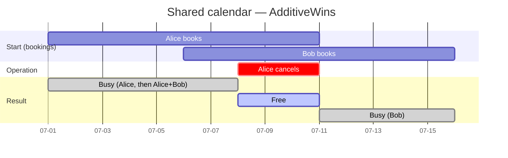
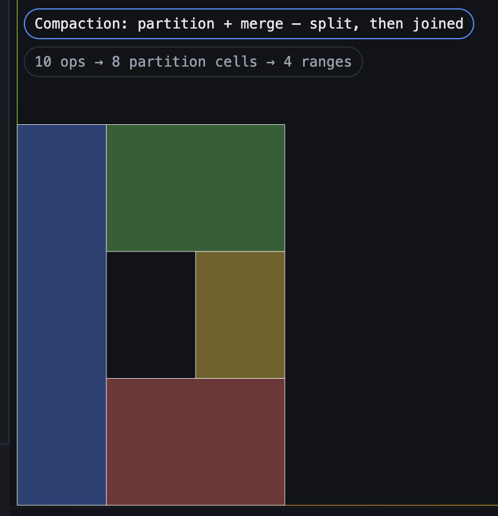
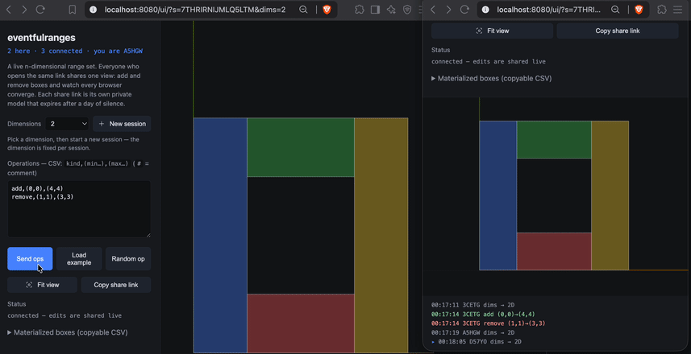

# eventfulranges

[](https://github.com/d-led/eventfulranges/actions/workflows/ci.yml)
[](https://codecov.io/gh/d-led/eventfulranges)
[](https://pkg.go.dev/github.com/d-led/eventfulranges)
[](LICENSE)

A CRDT for real-valued ranges. Any number of replicas add and remove ranges on
their own, and every replica that has seen the same operations ends up with the
same set, whatever order they arrive in. No coordinator, no consensus.

| You want | Mechanism |
| --- | --- |
| Several writers, no lock | `Add`/`Remove` locally, then exchange `Ops()` and call `ApplyAll` |
| Your choice of durability | `store.Log`: a JSON Lines file, memory, KurrentDB, or your own |
| Your choice of transport | channels, pub/sub, HTTP, an event log; convergence does not care |
| Ranges or n-D boxes | `float64` intervals in 1-D; the `space` package for boxes in any dimension |

```shell
go get github.com/d-led/eventfulranges
```

Start here: [Quick start](#quick-start) · [Strategies](#strategies) ·
[Packages](#packages) · [Demos](#demos).

Read further: [CRDT map](docs/CRDT.md) · [Design](docs/DESIGN.md) ·
[n-D ranges](docs/N-DIM.md) · [Extensions](docs/EXTENSIONS.md) ·
[WebAssembly build](docs/WASM.md).

## Quick start

Open a replica; the store decides where operations live:

```go
set, _ := eventfulranges.Open(ctx, "./example", strategy.LWW) // → ./example/ranges.stream.jsonl
```

Add and remove ranges. `[1,10]` minus `[3,5]` leaves a hole:

```go
_, _ = set.Add(ctx, 1, 10)
_, _ = set.Remove(ctx, 3, 5)

for _, iv := range set.Ranges() {
    fmt.Println(iv) // [1,3)
                    // (5,10]
}
```

Converge two replicas by exchanging operations, never state:

```go
_ = a.ApplyAll(ctx, b.Ops())
_ = b.ApplyAll(ctx, a.Ops())
// now a.Ranges() == b.Ranges()
```

The rest of this page covers choices: which strategy, which store, which
transport.

## Example: a shared calendar

A date is a day number, so a date range is a plain `float64` interval. Two
people book overlapping vacations, one cancels part of hers, and the busy set is
the union of bookings minus cancellations:

```go
cal, _ := eventfulranges.OpenStore(ctx, memory.New(), strategy.AdditiveWins)
book, cancel := func(f, t string) { _, _ = cal.Add(ctx, days(f), days(t)) },
                func(f, t string) { _, _ = cal.Remove(ctx, days(f), days(t)) }

book("2026-07-01", "2026-07-10")   // Alice's vacation
book("2026-07-06", "2026-07-15")   // Bob's vacation (overlaps)
cancel("2026-07-08", "2026-07-10") // Alice cuts the trip short

cal.Contains(days("2026-07-01")) // true  — booked
cal.Contains(days("2026-07-08")) // false — cancelled
cal.Contains(days("2026-07-12")) // true  — Bob's still away
```



`AdditiveWins` makes that add up: the busy set is the union of all bookings
minus the union of all cancellations, so concurrent edits converge in any order.

Full program: [`examples/calendar`](examples/calendar), its own module that
imports the library by version from the module proxy, with no `replace`
directive.

## Storage & transport

A replica is a `store.Log` plus a strategy. Three backends ship in the repo,
and you can plug in your own:

```go
set, _ := eventfulranges.Open(ctx, "./example", strategy.LWW)         // JSON Lines stream (default)
set, _ := eventfulranges.OpenStore(ctx, memory.New(), strategy.LWW)   // in memory
set, _ := eventfulranges.OpenStore(ctx, myBackend, strategy.LWW)      // your own store.Log
```

`Open` keeps the append-only stream as JSON Lines
(`./example/ranges.stream.jsonl`). Snapshots are records in that same stream,
not a sidecar file, which is what lets `Compact` rewrite the stream in place
without losing history. The stream is the source of truth; a snapshot record
only fast-forwards a restart.

Transport is your choice too: convergence is shipping `Ops()` and calling
`ApplyAll`. [Demos](#demos) shows channels, a pub/sub bus and HTTP;
[KurrentDB](#kurrentdb) shows the event-database backend.

## Strategies

| Strategy       | Semantics                                          |
| -------------- | -------------------------------------------------- |
| `LWW`          | Highest `(timestamp, id)` wins at each point       |
| `FWW`          | Lowest `(timestamp, id)` wins at each point        |
| `AdditiveWins` | Union of all additions minus union of all removals |
| `GrowOnly`     | Union of all additions, removals ignored           |

## Packages

| Package                       | Purpose                                              |
| ----------------------------- | ---------------------------------------------------- |
| `interval`                    | 1-D open/closed intervals with canonical set algebra |
| `op`                          | The append-only operation (`add` / `remove`)         |
| `clock`                       | Hybrid logical clock and Lamport clock               |
| `strategy`                    | Conflict resolution: materializes ops to a set       |
| `engine`                      | Concurrency-safe log + view, snapshotting            |
| `store`                       | The `EventStore` interface (append/read/snapshot)    |
| `store/memory`, `store/jsonl` | In-memory and file backends                          |
| `space`                       | n-dimensional generalization (half-open boxes)       |
| `rtree`                       | Ephemeral bulk-loaded R-tree over `space.Box`        |
| `meta`                        | CRDT join for JSON-object metadata                   |

The n-dimensional stack mirrors the 1-D one package for package (`space/op`,
`space/strategy`, `space/store`, `space/engine`); see [docs/N-DIM.md](docs/N-DIM.md).

The public facade is the root package `eventfulranges`.

## Coordinates

Range endpoints are `float64`. Integers convert exactly while they fit the
53-bit mantissa (`|n| <= 2^53`); fractional values are stored and compared
verbatim, so no rounding error accumulates. There is no `math/big` coordinate
type, so endpoints beyond `2^53` round to the nearest representable value.
`int64` carries bookkeeping only (operation timestamps, log-version counters),
never a coordinate.

## Demos

Each demo does the same thing: replicas mutate their own copy, exchange
operations and converge. They differ only in transport and storage.

- [hello](#hello) — one replica, no transport: add, remove, print the ranges
- [local](#local) — three goroutine replicas trade ops over channels until they agree
- [pubsub](#pubsub) — the same replicas through a bus, never addressing each other
- [network](#network) — two processes, two HTTP servers: `GET /ops`, `POST /ops`
- [web](#web) — 1–4D box visualizer; every browser on a share link sees one model
- [paint](#paint) — whiteboard where one stroke is one box op
- [kurrent](#kurrentdb) — the op log in KurrentDB instead of a JSONL file
- [automerge and go-automerge](#automerge-and-go-automerge) — the same convergence under a different CRDT

### hello

```shell
go run ./demo/hello
```

`demo/hello` is one replica with no transport: open an in-memory set, add,
remove, print what is left. The smallest program in the repo.

### local

```shell
go run ./demo/local
```

Three in-memory replicas. Each one mutates its own copy from its own goroutine,
then trades `Ops()` until they agree. The transport is Go channels: no
network, no lock.

### pubsub

```shell
go run ./demo/pubsub
```

The same three replicas through a bus instead of direct links: each subscribes
to a topic on a `github.com/cskr/pubsub/v2` bus, mutates locally, and publishes
its own operations. Nothing addresses anybody, and they still converge.

### network

```shell
go run ./demo/network
```

Two processes, each behind its own HTTP server, with no CRDT protocol between
them: a peer exports its log as `GET /ops` (JSON) and folds yours in with
`POST /ops`. Each mutates its own copy, then the two exchange logs; ports come
from `-ports 18080,18081`.

### web

```shell
go run ./demo/web
```

```ruby
add (0,0)→(1,1)
add (1,0)→(2,1)
add (2,0)→(3,1)
add (0,1)→(1,2)
add (1,1)→(2,2)
add (2,1)→(3,2)
add (0,2)→(1,3)
add (1,2)→(2,3)
add (2,2)→(3,3)
remove (1,1)→(2,2)
```

&darr;



`demo/web` serves an n-dimensional range-set visualizer: 1 to 4 dimensions, a
rotatable translucent 3D view, and copy-pasteable CSV. Everyone on the same
instance shares one view. Each `add`/`remove` folds in arrival order and
broadcasts over a WebSocket, so every screen converges on the same model. The
newest operation at a point decides it, which is what lets you paint over a hole
you just cut. Open `http://localhost:8080/ui/`.

The panel names the build you are looking at: the served one names its hub, the
browser-only one says that nothing syncs.

A hub also answers read-only region queries: a client sends
`{"kind":"search","min":[…],"max":[…]}` and gets the boxes overlapping that
region. The index is an ephemeral R-tree (`rtree`), dropped on every edit and
rebuilt on the next query, so a query costs `O(log n + k)` instead of a scan.
The tree keeps no state, so two hubs that converged on the same boxes answer
identically.

One command starts it; the other scripts cover the rest:

```bash
./scripts/demo-web.sh     # start the web visualizer (open the printed URL)
./scripts/build-web.sh    # (re)build the embedded UI (npm install + esbuild)
./scripts/itest-web.sh    # smoke test: unit tests + server serves the UI
./scripts/e2e-web.sh      # Playwright end-to-end tests
```

#### Running purely in the browser (WebAssembly)

Live demo: <https://d-led.github.io/eventfulranges/>, deployed by
`.github/workflows/pages.yml` on every push to `main`.

The same visualizer runs with no Go server at all: the session hub compiles to
WebAssembly (`GOOS=js GOARCH=wasm`) and runs inside the page, so the UI works
from any static host. Both builds speak the same JSON envelopes and share the
rendering code. Two switches choose between them:

- **A session-engine interface** (`demo/web/ui-src/server-engine.js` or
  `local-engine.js`): the WebSocket transport, or a direct call into the in-page
  Go engine (`demo/web/wasm.go`). Choose with `?engine=local`, or open the local
  build, whose page preselects it.
- **A log repository** (`demo/web/persist.go`, or the browser's `localStorage`
  reserve): the server appends each operation to a JSONL file; the in-page
  engine replays the browser's local copy on reload, as a reconnecting socket
  would.

```bash
./scripts/build-local.sh  # build demo/web/dist-local: UI + engine.wasm + wasm runtime
./scripts/serve-local.sh  # build and serve it statically (any static host works)
./scripts/watch-local.sh  # serve it and rebuild on every UI or Go change (dev loop)
./scripts/e2e-local.sh    # Playwright tests against the in-page wasm engine
```

Each demo has a smoke test: `go test ./demo/...`. UI unit tests sit next to the
modules they cover as `*.unit.test.mjs`, so the runner finds them by convention.
`npm run test:unit` in `demo/web` is plain `node --test`; `demo/paint` gives
vitest the same glob. Playwright specs live under `tests/`.



#### Reading the counts: operations, partition cells, ranges

The corner of the view reports the counts consolidation passed through, in
order. The built-in 3D example shows `28 ops → 26 partition cells → 8 ranges`:

- **operations**: the lines you send (`add,(0,0),(2,2)`). They are all that is
  stored; the activity log lists them, and the range CSV is what they left
  behind.
- **partition cells**: the set cut along every operation's faces so that no two
  pieces overlap. A cell is in the set or out of it, never covered twice. Cells
  are an intermediate of the partition modes, not stored and not drawn.
- **ranges**: the cells joined back into as few boxes as the merge can make.
  This is what the view draws and the range CSV lists.

A count is omitted when it would repeat its neighbor: without a partition there
are no cells, and in partition mode the cells are the ranges. For the same two
operations that make an L:

  nothing merges. Two boxes sharing a whole face read `2 ops → 1 range`.
- `partition` — `2 ops → 5 ranges`: the cut is the result, so only the two ends
  are shown.
- `partition + merge` — `2 ops → 5 partition cells → 3 ranges`: the only mode
  that shows all three counts.

Those operations, one square per unit interval; a label repeated over squares
that form a rectangle is *one* box:

    canonical mode — 2 boxes, and they overlap

        ┌────┬────┬────┐
        │    │ B  │ B  │  y2
        ├────┼────┼────┤
        │ A  │ AB │ B  │  y1    both operations cover AB
        ├────┼────┼────┤
        │ A  │ A  │    │  y0
        └────┴────┴────┘
          x0   x1   x2

    partition mode — 5 cells, no two of them share a point

        ┌────┬────┬────┐
        │    │ d  │ e  │  y2
        ├────┼────┼────┤
        │ a  │ c  │ e  │  y1    a (0,0)-(1,2), b (1,0)-(2,1), c (1,1)-(2,2)
        ├────┼────┼────┤        d (1,2)-(2,3), e (2,1)-(3,3)
        │ a  │ b  │    │  y0
        └────┴────┴────┘
          x0   x1   x2

    partition + merge mode — 3 ranges: the cells joined back up

        ┌────┬────┬────┐
        │    │ d  │ e  │  y2
        ├────┼────┼────┤
        │ R  │ R  │ e  │  y1    R (0,0)-(2,2) is operation A rebuilt from its
        ├────┼────┼────┤        cells; d and e are the rest of B
        │ R  │ R  │    │  y0
        └────┴────┴────┘
          x0   x1   x2

Both counts come from the same cut. When the operations do not overlap, cells
and operations nearly coincide: the built-in 3D example (27 unit cubes, the
middle one carved out) reports 26 cells → 8 ranges, so 28 operations answer for
8 boxes. When they do overlap, every new face cuts the pieces already there, so
cells grow far faster than operations: a 3D session whose log held ~90
overlapping operations reached 3117 cells → 106 ranges, and the view draws those
106 boxes. `canonical` and `merge adjacent` never report cells: no partition
runs.

### paint

```shell
go run ./demo/paint
```

A whiteboard with no edges: one stroke is one half-open `add`/`remove` box, so a
filled rectangle of cells costs one operation. Browsers receive the operation
log and build the view themselves, which is plain event sourcing, so concurrent
strokes converge in any order. The share link is the session URL, and the raw
log downloads as JSONL. Open `http://localhost:8081/ui/`.

```bash
./scripts/demo-paint.sh     # start the whiteboard (open the printed URL)
./scripts/build-paint.sh    # (re)build the embedded UI (npm install + esbuild)
./scripts/itest-paint.sh    # smoke test: Go tests + server serves the UI
./scripts/e2e-paint.sh      # vitest unit tests + Playwright end-to-end tests
```

#### Admin area

The server exposes an admin area (`/admin/`, see `demo/paint/ui-src/admin.html`)
for inspecting instance storage and deleting inactive sessions. In the deployed
build the `ADMIN_EMAILS` reverse-proxy allow-list gates it, so only listed users
reach it. A development build (no `embed` tag) opens the gate to direct requests
when `ADMIN_EMAILS` is unset, which makes the area usable locally without an
oauth2-proxy; with `ADMIN_EMAILS` set it is gated as in deployment. The dev-only
gate is compiled out of embedded artifacts, so it cannot leak into a deployed
binary.

#### Related — infinite canvases and zoom-first editors

- [tldraw](https://tldraw.dev) — open-source infinite canvas, real-time collaboration
- [Excalidraw](https://excalidraw.com) — infinite canvas, CRDT (Yjs) collaboration ([source](https://github.com/excalidraw/excalidraw))
- [Miro](https://miro.com) — infinite canvas, real-time collaboration
- [FigJam](https://www.figma.com/figjam/) — infinite canvas, real-time collaboration
- [InfiniPaint](https://infinipaint.com) — collaborative canvas with no zoom limit
- [Endless Paper](https://www.endlesspaper.app) — single-user infinite canvas
- [Prezi](https://prezi.com) — presentations on a zoomable canvas

### automerge and go-automerge

Two replicas edit a shared JSON document concurrently, sync, and land identical:
the [local](#local) story with Automerge underneath instead of this library.
Automerge builds conflict resolution in; here you choose it (`LWW`, `FWW`,
`AdditiveWins`, `GrowOnly`).

```bash
./scripts/demo-automerge.sh      # tests + run, via automerge-go (needs cgo)
./scripts/demo-go-automerge.sh   # tests + run, via the pure-Go port (no cgo)
```

Neither demo touches the library; the Automerge dependencies live only in
`demo/go.mod`.

## Quality

`scripts/quality-gate.sh` is the single gate: format, lint, tests, property
tests, fuzz, mutation, both UI builds, the WebAssembly build and every Playwright
suite. On CI it is a manual `workflow_dispatch` job (`quality-gate`, 45-minute
timeout); every push and pull request runs the fast path, `golangci-lint` on
both modules plus `scripts/test.sh`. The Kurrent integration test has its own
job.

The gate checks:

- `gofumpt` formatting
- `go vet`, `staticcheck`, `golangci-lint`, `gocyclo` (complexity ≤15),
  `revive`, `gosec`, `govulncheck`, `jscpd` (duplication ≤0.5%)
- unit tests with the race detector, at **100% statement coverage** of every
  library package (the gate prints the total; a shortfall is not yet a hard
  failure)
- property-based tests (`pgregory.net/rapid`) checked against a **biogo
  interval-tree oracle**, plus Jepsen-style concurrent scenarios
- fuzz smoke tests (Go native fuzzing)
- mutation testing (`gremlins`, ≥80% efficacy and ≥80% mutant coverage)

Run it locally:

```bash
./scripts/test.sh        # fast: unit tests + coverage report
./scripts/quality-gate.sh # full: format, lint, tests, property, fuzz, mutation, e2e
./scripts/lint.sh --install # install any missing static-analysis tools
./scripts/update-dependencies.sh # bump every module to its latest deps
```

## KurrentDB

[KurrentDB](https://kurrent.io) (formerly EventStoreDB) is the event-database
backend, behind the `kurrent` build tag: the operation log is a KurrentDB
stream, with snapshots in the same store.

```bash
./scripts/kurrent-up.sh          # docker compose up -d (needs Docker)
./scripts/demo-kurrent.sh        # run the KurrentDB-backed demo
./scripts/itest-kurrent.sh       # integration tests (build tag kurrent)
./scripts/kurrent-down.sh
```

`demo/kurrent` stores the same add/remove pair in KurrentDB instead of an
in-memory store, so the only difference from `demo/hello` is which `store.Log`
the replica is opened with. To run it by hand:

```bash
cd demo/kurrent && go run -tags kurrent .
```

## Docs

| Document | Answers |
| --- | --- |
| [CRDT map](docs/CRDT.md) | which strategy, which dimension, and where each lives |
| [Design](docs/DESIGN.md) | the model, the packages, the reasoning |
| [n-D ranges](docs/N-DIM.md) | boxes, the n-D engine, paint layers |
| [Extensions](docs/EXTENSIONS.md) | canonicalizers, metadata, merge verification, region queries |
| [WebAssembly build](docs/WASM.md) | the browser-only build and its GitHub Pages deploy |
| [llms.txt](llms.txt) | the same map in the form an agent routes from |
| [AGENTS.md](AGENTS.md) | build commands, layout and invariants for contributors |

## Citation

The code is citable: [`CITATION.cff`](CITATION.cff) is what GitHub's *Cite this
repository* button reads, and Zenodo mints a DOI for each release.

## License

[MPL-2.0](LICENSE)
